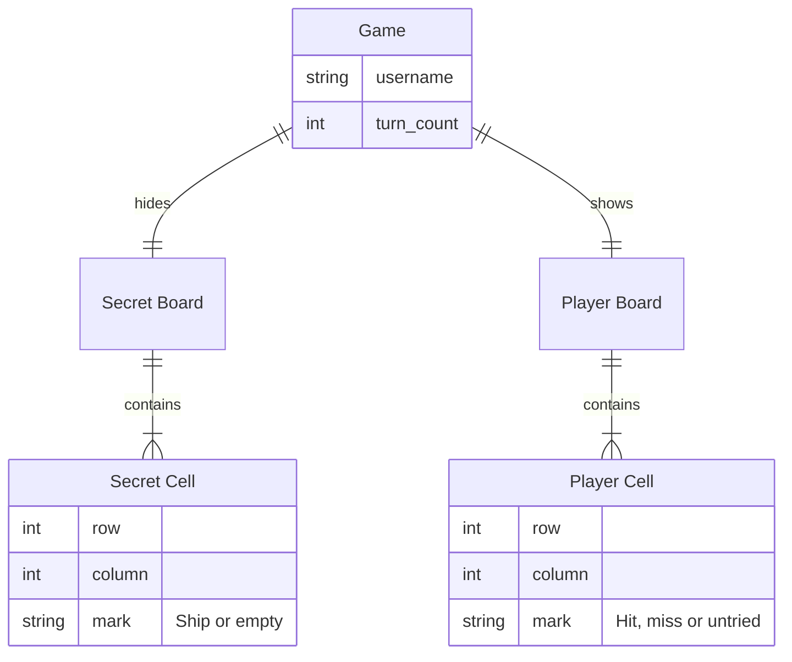

# Ships That Battle

A terminal Battleship-style game written in Python, with a browser-terminal wrapper from Code Institute.

**Python · Terminal game**

[Getting started](#getting-started) · [Data model](#entity-relationship-diagram) · [Repository guide](#repository-guide) · [Checks](#checks-and-review) · [Credits](#credits-and-reuse)

## What you can explore

- Enter coordinates to find hidden ships.
- Receive hit and miss feedback in the terminal.
- Inspect the Python game separately from the Node.js web wrapper.

> **Project notes:** The package.json test script is a placeholder. The simplest local entry point is the Python game; the browser wrapper is a separate hosting integration.

## Entity relationship diagram

The Python game keeps two 8 × 8 boards in memory. The secret board places five ships in distinct cells, and the player board marks the coordinates that have been hit or missed. The player also has a running turn count. [Python game](run.py)



## Getting started

Requires Git, Python 3. The terminal game uses the standard library.

```bash
git clone https://github.com/SamOBrienOlinger/Ships-that-Battle.git
cd Ships-that-Battle
python3 run.py
```

Follow the prompts to choose rows **1–8** and columns **A–H**. The Node.js files provide a separate browser-terminal hosting wrapper and are not required for local terminal play.

## Repository guide

| Path | Purpose |
| --- | --- |
| [assets/](assets/) | Project styles, scripts, data and imagery |
| [package.json](package.json) | Package dependencies and available commands |

## Checks and review

No automated application test command is configured in this snapshot.

Play through valid, invalid and repeated coordinates, then check both game outcomes.

## Credits and reuse

Design decisions, original feature notes, historical testing evidence and detailed acknowledgements remain available in the preserved project record:

- [README.md · original project record](https://github.com/SamOBrienOlinger/Ships-that-Battle/blob/7e0334bea361e6888bc023f98e542fd4a124eb4d/README.md)

Learning resources and starter material: [Code Institute](https://codeinstitute.net/).

No repository-level licence file is present in this snapshot. This README does not grant additional reuse permissions. Check with the relevant rights holders before reusing code, written content or assets.

## Support

Repository maintained in [Sam O’Brien-Olinger’s GitHub account](https://github.com/SamOBrienOlinger). For a problem or suggested improvement, [open an issue](https://github.com/SamOBrienOlinger/Ships-that-Battle/issues) with the affected page or command, steps to reproduce, and expected behaviour.

[Back to top](#ships-that-battle)
